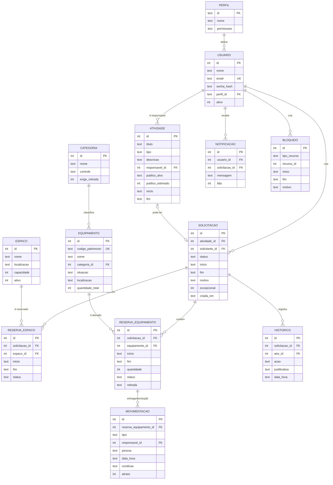
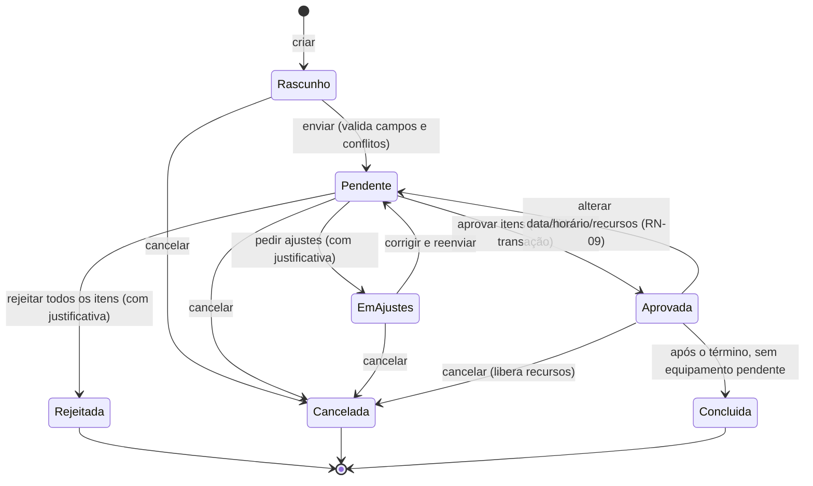
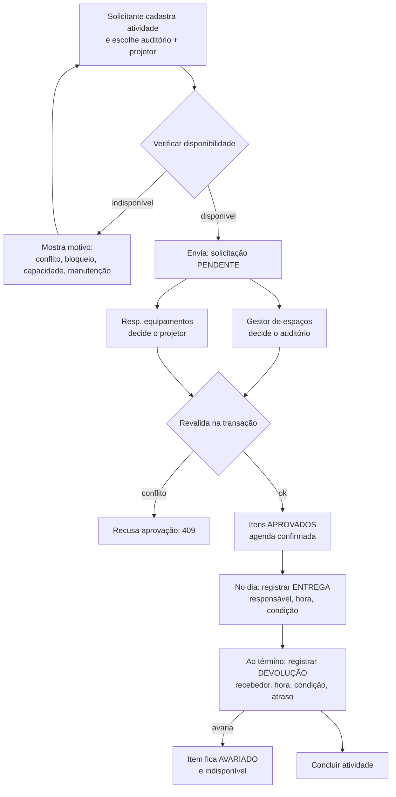
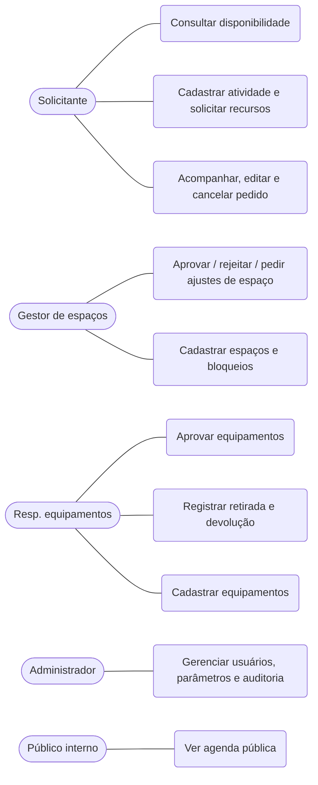

# Modelagem

Os diagramas estão em [Mermaid](https://mermaid.js.org). No VS Code, instale a extensão **Markdown Preview Mermaid Support** e abra a pré-visualização (`Ctrl+Shift+V`). No GitHub, eles aparecem renderizados automaticamente.

## DER (modelo de dados)

Tabelas de apoio fora do diagrama: `sessao` (login), `parametro` (políticas configuráveis) e `log_auditoria` (ações administrativas).

**Cuidados da especificação atendidos:**
- Item individual (`controle = INDIVIDUAL`) é separado de item com estoque (`controle = QUANTIDADE`, com `quantidade_total`).
- Não existe um campo booleano "disponível": a disponibilidade é **calculada** para cada intervalo a partir das reservas aprovadas, dos bloqueios e da situação do item.

## Estados da solicitação

## Processo: atividade com múltiplos recursos (10.1 a 10.3)

## Casos de uso

